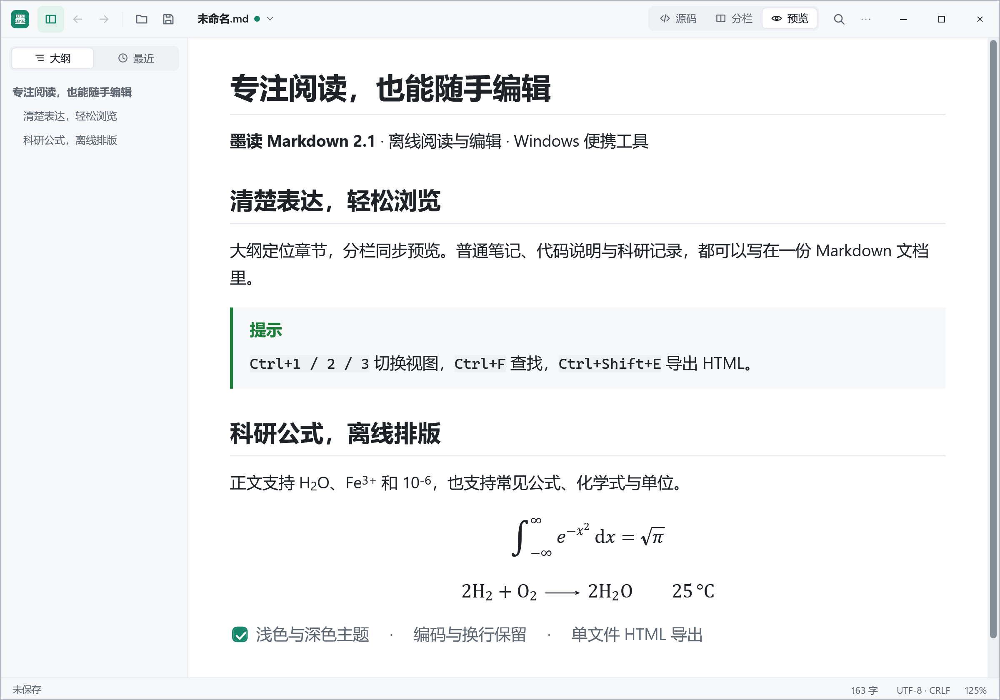
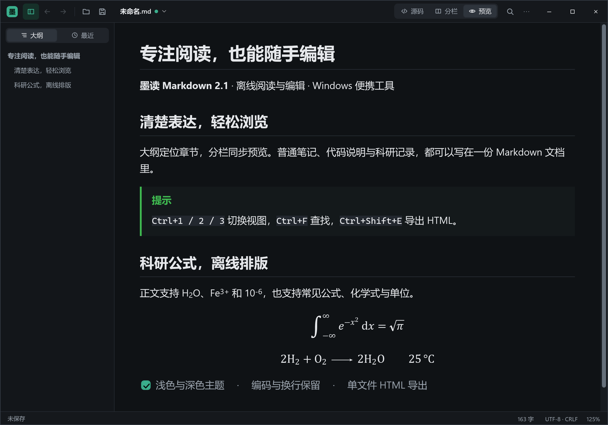

# 墨读 Markdown

轻量、离线、免安装的 Windows Markdown 阅读与编辑器。专注阅读，也能一边编辑，一边查看公式、代码和图文的排版效果。

**[下载 v2.1 便携版](https://github.com/Nanamiwww/modu-markdown/releases/download/v2.1/ModuMarkdown-2.1-win.zip)** · [发布说明](https://github.com/Nanamiwww/modu-markdown/releases/tag/v2.1) · [使用说明](使用说明.md) · [问题反馈](https://github.com/Nanamiwww/modu-markdown/issues)

Windows 10 / 11 · .NET Framework 4.8 · 中文界面 · 源码与构建脚本已提供

<p align="center"></p>
<p align="center"><sub>浅色主题 · 阅读与科研公式 · 点击图片查看清晰原图</sub></p>

## 2.1 更新

本版修复科研数值命令中的行尾 `%` 注释处理。例如，`\num{123%` 换行后接 `}` 现在显示为 **123**；数值范围、角度、列表以及 `\SI` / `\qty` 的数值部分也按同样规则处理。直接书写、宏体和 HTML 导出的处理保持一致。

化学式、物理量、单位参数和网址中的 `%` 保持原有含义，例如 `\SI{98}{%}` 仍表示百分比。

相较此前发布的 v2.0，本版还汇集了矩阵与多行公式、自定义命令、化学式和单位排版，以及保存冲突、编码识别、草稿恢复和长文档处理等改进。完整细节见 [更新记录](CHANGELOG.md)。

## 阅读与编辑

- **三种视图**：源码、分栏、预览；使用 `Ctrl+1` / `Ctrl+2` / `Ctrl+3` 切换，分栏支持同步滚动。
- **快速定位**：标题大纲、当前章节高亮、最近文件、查找和缩放，方便浏览长文档。
- **Markdown 排版**：表格、嵌套列表、任务列表、脚注、GitHub 提示块、带复制按钮的代码块和正文上下标。
- **主题选择**：浅色、深色、跟随系统及 Windows 高对比度。
- **文件与草稿**：保留原文件编码和换行方式；外部改动自动刷新或提示冲突；支持自动草稿与异常退出后的恢复。
- **导出与分享**：导出单文件 HTML，本地图片和公式内嵌；通过 Windows 打印对话框打印或导出 PDF。

## 面向科研文档的公式支持

内置离线公式排版器支持常见 LaTeX 写法，包括分式、上下标、求和、积分、伸缩括号、矩阵、`cases` / `aligned` 等多行环境，以及 `\tag` 编号、`\eqref` 引用和常用自定义命令。

还支持 `\ce{}` 化学式、`\pu{}` 物理量，以及 `\SI`、`\si`、`\num` 等常用 siunitx 写法。正文可用 `H~2~O` 和 `Fe^3+^` 表达下标与上标。

<details>
<summary><b>查看深色主题与公式排版截图</b></summary>

<p align="center"></p>

</details>

> 公式支持的是内置的常用语法子集，并非完整 TeX 或第三方宏包运行环境。无法排版的公式会显示原文并说明原因。具体支持范围与示例见 [使用说明](使用说明.md) 和 [科研公式示例](samples/科研公式示例.md)。

## 开始使用

1. 下载 **[ModuMarkdown-2.1-win.zip](https://github.com/Nanamiwww/modu-markdown/releases/download/v2.1/ModuMarkdown-2.1-win.zip)**，完整解压。
2. 双击 `CodexMarkdownReader.exe` 启动。
3. 打开或拖入 `.md` 文件；也可以先阅读随包的 `示例文档.md` 和 `科研公式示例.md`。

需要 **Windows 10 / 11 和 .NET Framework 4.8**。便携包不包含 .NET 运行时，使用前需确认系统已安装或启用相应版本。程序无需安装，可复制整个文件夹迁移。

发布页中的 **Source code (zip / tar.gz)** 是本版本的源码归档；直接运行软件请下载上方的 Windows 便携包。

程序可离线使用，不自动加载网络图片，不执行文档中的脚本；导出 HTML 时网络图片保留为链接。设置、最近文件和草稿保存在 `%LOCALAPPDATA%\CodexMarkdownReader`。

## 文件校验

[SHA256SUMS.txt](https://github.com/Nanamiwww/modu-markdown/releases/download/v2.1/SHA256SUMS.txt) 可用于核对下载文件。v2.1 Windows 便携包的 SHA-256 为：

```text
AFA9E31989F61E7FDD209DFC10073FC15172F56B2450BBEA0CDE326CD93E984E
```

## 从源码构建

源码位于 `src/`，图标、应用清单和随包示例位于 `release-tools/`。在满足运行环境要求的 Windows 上双击 `build.cmd`，脚本会使用 .NET Framework 的 C# 编译器构建，然后运行内置自检；任何一项失败都会让构建失败。

也可以运行：

```powershell
powershell -NoProfile -ExecutionPolicy Bypass -File build.ps1
```

输出位于 `dist/`：`CodexMarkdownReader.exe`、`build-log.txt` 和逐项列出的 `selftest-report.txt`。本次发布准备中，源码构建和随包程序分别运行内置自检，均为 **351 项通过、0 项失败**。

<details>
<summary><b>项目结构与发布方法</b></summary>

```text
src/
  App/        程序入口与版本信息
  Core/       设置、编码、换行与草稿恢复
  Markdown/   Markdown 解析器
  Rendering/  预览、公式排版、HTML 导出与资源策略
  UI/         主窗口、主题与交互
  Platform/   Windows 集成
  Tests/      内置自检
release-tools/  图标、应用清单和随包文档
samples/        手动检查排版的示例
docs/           软件截图
```

发布新版本时，在 `src/App/Program.cs` 更新版本号，在 `CHANGELOG.md` 记录改动；构建并确认自检通过后，将程序、`使用说明.md` 和 `release-tools/package/` 中的内容一起打包，作为对应标签的 Release 附件上传。

</details>

欢迎在 [Issues](https://github.com/Nanamiwww/modu-markdown/issues) 中提供软件版本、Windows 版本、复现步骤，以及去除私人信息后的最小示例文档。
