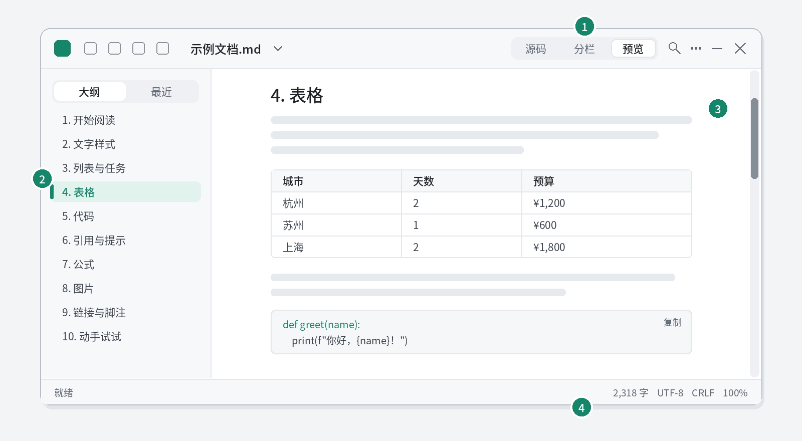

<!--
如果你在记事本里看到了这段文字和满屏的 # * | 符号：
请双击同一文件夹里的 CodexMarkdownReader.exe，再把这个文件拖进打开的窗口，就能看到排版后的效果。
-->

# 墨读 Markdown 示例文档

你好！这是一份用 **Markdown** 写成的示例文档，也是墨读的上手指南。你看到的标题、表格、代码、公式和图片，都是从一个纯文本文件实时排版出来的。

> [!TIP]
> 按 <kbd>Ctrl</kbd> + <kbd>2</kbd> 切换到“分栏”视图：左边是 Markdown 原文，右边是排版效果，对照着看最直观。按 <kbd>Ctrl</kbd> + <kbd>3</kbd> 回到纯阅读。

## 1. 开始阅读



1. **视图切换**：源码 / 分栏 / 预览，快捷键 <kbd>Ctrl</kbd> + <kbd>1</kbd> / <kbd>2</kbd> / <kbd>3</kbd>。
2. **侧栏**：“大纲”列出所有标题，单击即可跳转，阅读时会自动高亮当前章节；“最近”记录打开过的文件。<kbd>Ctrl</kbd> + <kbd>Shift</kbd> + <kbd>O</kbd> 显示或隐藏侧栏。
3. **正文**：<kbd>Ctrl</kbd> + 滚轮缩放，<kbd>Ctrl</kbd> + <kbd>F</kbd> 查找。
4. **状态栏**：字数、文件编码、换行符和缩放比例。

打开其他文件：把 `.md` 文件拖进窗口，或者按 <kbd>Ctrl</kbd> + <kbd>O</kbd>。

## 2. 文字样式

**加粗**、*斜体*、***加粗斜体***、~~删除线~~、`行内代码`、<mark>高亮</mark>、H<sub>2</sub>O、x<sup>2</sup>，以及按键 <kbd>Ctrl</kbd> + <kbd>S</kbd>。下标和上标也可以直接写成 H~2~O、Fe^3+^。

Markdown 由 John Gruber 在 2004 年提出，用 `**` 表示加粗、`#` 表示标题，写起来和普通文字几乎一样。中英文混排、**“紧贴引号的加粗”**、变量名 snake_case_name 都能正确显示。

## 3. 列表与任务

购物清单（无序列表，可以嵌套）：

- 水果
  - 苹果
  - 香蕉
- 牛奶
- 面包

周末安排（有序列表）：

1. 上午：整理房间
2. 下午：去图书馆还书
3. 晚上：看一部电影

待办事项（任务列表）：

- [x] 收到墨读压缩包
- [x] 打开这份示例文档
- [ ] 用 Markdown 写下自己的第一篇笔记

## 4. 表格

一次江南三城之旅的预算（“天数”一列居中，“预算”一列右对齐）：

| 城市 | 天数 | 预算 |
|:--|:-:|--:|
| 杭州 | 2 | ¥1,200 |
| 苏州 | 1 | ¥600 |
| 上海 | 2 | ¥1,800 |
| **合计** | **5** | **¥3,600** |

## 5. 代码

行内代码写作 `print("hello")`。代码块可以标注语言，右上角有“复制”按钮：

```python
def greet(name):
    """向某人问好"""
    print(f"你好，{name}！欢迎使用墨读。")

greet("朋友")
```

## 6. 引用与提示

> 普通引用适合摘录别人的话。
>
> > 引用还可以嵌套。

> [!NOTE]
> 补充说明：不看也不影响理解的信息。

> [!TIP]
> 小技巧：<kbd>Ctrl</kbd> + <kbd>Shift</kbd> + <kbd>L</kbd> 在浅色、深色主题之间切换。

> [!IMPORTANT]
> 重要：关键的信息放在这里。

> [!WARNING]
> 提醒：墨读不会执行文档里的脚本，也不会自动加载网络图片，打开来历不明的文档也比较放心。

> [!CAUTION]
> 注意：可能带来风险的操作放在这里。

## 7. 公式

行内公式：勾股定理 $a^2 + b^2 = c^2$。

一元二次方程的求根公式：

$$ x = \frac{-b \pm \sqrt{b^2 - 4ac}}{2a} $$

前 $n$ 个正整数之和：

$$ \sum_{k=1}^{n} k = \frac{n(n+1)}{2} $$

高斯积分：

$$ \int_{-\infty}^{\infty} e^{-x^2}\,dx = \sqrt{\pi} $$

矩阵和带编号的公式：

$$ \begin{pmatrix} \cos\theta & -\sin\theta \\ \sin\theta & \cos\theta \end{pmatrix}\begin{pmatrix} x \\ y \end{pmatrix} = \begin{pmatrix} x' \\ y' \end{pmatrix} \tag{1} $$

化学方程式写在 `\ce{…}` 里，反应条件写在箭头后的方括号中：

$$ \ce{2KMnO4 ->[\Delta] K2MnO4 + MnO2 + O2 ^} $$

$$ \ce{N2 + 3H2 <=>[催化剂][高温、高压] 2NH3} $$

离子和单位：$\ce{SO4^2-}$、$\ce{[Cu(NH3)4]^2+}$，重力加速度 $g=\SI{9.8}{\metre\per\second\squared}$，标准大气压 $\SI{101.325}{\kilo\pascal}$。更多化学式、单位和公式的写法见同一文件夹里的[科研公式示例](科研公式示例.md)。

## 8. 图片

小图按原始大小显示，比如这个 48 像素的图标：


第 1 节那张界面图比正文宽，会自动缩小到栏宽。单击图片可以用系统的看图软件打开原图。

## 9. 链接与脚注

- 文档内跳转：[回到“表格”一节](#4-表格)
- 打开同一文件夹里的另一份文档：[使用说明](使用说明.md)（看完按 <kbd>Alt</kbd> + <kbd>←</kbd> 返回）
- 网址会自动识别：https://commonmark.org
- 脚注会汇总到文末[^1]，点击编号就能跳过去。

## 10. 动手试试

1. 按 <kbd>Ctrl</kbd> + <kbd>2</kbd> 进入分栏视图，在左边随便改几个字，右边会立刻更新。
2. 按 <kbd>Ctrl</kbd> + <kbd>S</kbd> 保存。墨读会保持文件原来的编码和换行方式。
3. 想分享给别人：“更多 → 导出 HTML”（<kbd>Ctrl</kbd> + <kbd>Shift</kbd> + <kbd>E</kbd>）生成一个网页文件，图片和公式都在里面；<kbd>Ctrl</kbd> + <kbd>P</kbd> 选择“Microsoft Print to PDF”可以导出 PDF。

改乱了也不要紧，重新从压缩包里解压一份就好。完整的功能和快捷键见[使用说明](使用说明.md)。

---

[^1]: 这是一条脚注。点击末尾的 ↩ 可以回到正文。
