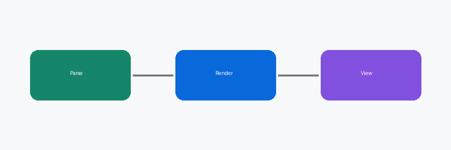

# 墨读 Markdown 功能演示

这份文档用来快速检查阅读器的排版效果。左侧侧栏会显示**大纲**，点击标题即可跳转；按 `Ctrl+F` 可以在预览中查找。

## 1. 列表

有序列表之间有空行时，编号会正常递增：

1. 安装依赖

   ```bash
   npm install
   ```

2. 启动开发服务器

3. 打开浏览器访问 <http://localhost:3000>

嵌套列表与任务列表：

- 第一层
  - 第二层
    - 第三层
- [x] 已完成的任务
- [ ] 待办任务

## 2. 文字样式

**加粗**、*斜体*、~~删除线~~、`行内代码`、<kbd>Ctrl</kbd> + <kbd>S</kbd>、H<sub>2</sub>O、x<sup>2</sup>、<mark>高亮</mark>。也可以用 H~2~O、Fe^3+^ 这样的写法表示下标和上标。

变量名 snake_case_name 不会被误认成斜体；中文引号**“紧贴加粗”**也能正确显示。
中文段落里的换行
不会在两个汉字之间插入多余空格。

裸网址会自动识别：https://github.com。脚注示例[^1]。

## 3. 表格

| 功能 | 旧版 | 新版 |
|:--|:-:|--:|
| 有序列表编号 | 全部是 1 | 正常递增 |
| 查找 | 无 | Ctrl+F |
| 外部修改 | 不刷新 | 自动刷新 |

## 4. 引用与提示

> 普通引用可以包含多种内容：
>
> - 列表项
> - 另一项
>
> > 嵌套引用

> [!TIP]
> 按 `Ctrl+1 / 2 / 3` 在源码、分栏和预览模式之间切换。

> [!WARNING]
> 打开可能包含宏的文件前，阅读器会先确认。

## 5. 公式

行内公式 $E = mc^2$，以及块级公式：

$$ D = \frac{d\bar{\varepsilon}}{dm} $$

$$ \sum_{i=1}^{n} x_i^2 \leq \sqrt{\alpha + \beta} $$

矩阵、分段函数与编号：

$$ A=\begin{pmatrix} a & b \\ c & d \end{pmatrix},\qquad |x|=\begin{cases} x, & x\ge 0 \\ -x, & x<0 \end{cases} \tag{1} $$

化学式与单位：$\ce{2H2 + O2 -> 2H2O}$，$\SI{9.81}{\metre\per\second\squared}$。更多例子见[科研公式示例](科研公式示例.md)。

## 6. 图片

小图标保持原始大小：

宽图会按栏宽缩小：



## 7. 链接

- [跳到“列表”一节](#1-列表)
- [本文件夹里的另一份文档](README.md)

---

[^1]: 这是脚注内容，点击右侧箭头可以返回正文。
